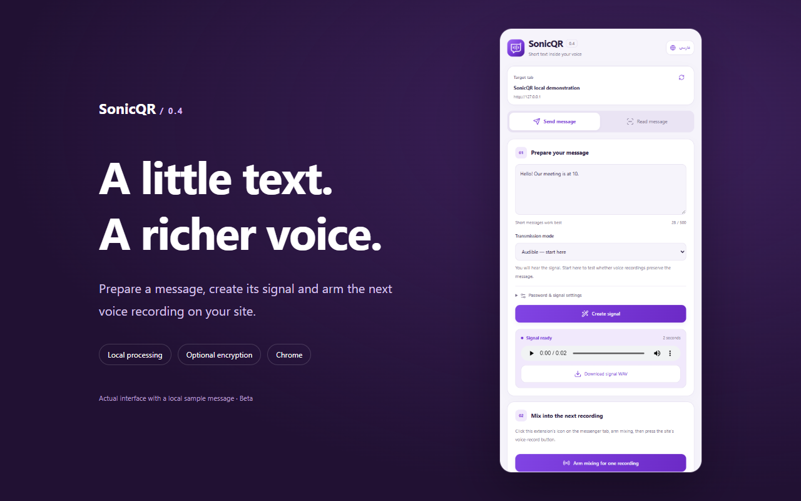
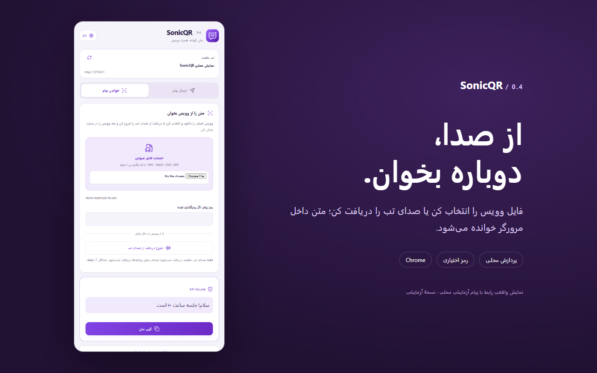

<div align="center">


**Short text inside sound. Processed locally. Built for Chrome.**

[](https://github.com/maboox/SonicQrChrome/actions/workflows/build.yml)


[](LICENSE)


[**⬇ Download**](https://github.com/maboox/SonicQrChrome/releases/tag/v0.4.0) · [**راهنمای فارسی**](docs/README.fa.md) · [**Privacy**](PRIVACY.md) · [**Report a bug**](https://github.com/maboox/SonicQrChrome/issues/new/choose)

</div>

SonicQR is an open-source Chrome side-panel extension that turns a short text message into an audio signal, mixes that signal into a website's voice recording, and recovers the text from an audio file or playing tab. A built-in recording lab lets you test the complete process before using a messenger.

> **Beta:** the browser recording paths are tested. Delivery through a messenger's compression is **not universally verified**. Start with a short audible message and decode the actual received file before relying on a service. High-frequency mode is experimental and may be filtered out entirely.

## A small studio beside your browser

| Write & prepare | Listen & recover |
|:---:|:---:|
|  |  |

- **Two ways to read:** choose the original audio file, or capture the selected tab while its voice message plays.
- **One-shot mixing:** arm one recording, then use the website's own record button. Nothing is sent automatically.
- **Optional encryption:** password-based AES-256-GCM protects message contents. Share the password separately.
- **English & فارسی:** full left-to-right and right-to-left interfaces, keyboard navigation, light and dark themes.
- **Local by design:** bundled codec, decoder worker and Lucide icons. No analytics, account or backend.
- **Visible control:** exact signal duration, recording status, cancellation, troubleshooting details and a session-clear button.

## Install

1. Download the `sonicqr-chrome-0.4.0-webstore.zip` asset from [Releases](https://github.com/maboox/SonicQrChrome/releases/tag/v0.4.0) and extract it into a permanent folder.
2. Open `chrome://extensions`, enable **Developer mode**, and select **Load unpacked**.
3. Select the folder containing `manifest.json`, then pin SonicQR to the toolbar.
4. Open the messenger's **web tab** and click the SonicQR icon.

Chrome 116 or newer on desktop is required. The ZIP is ready to load; building from source is optional. After an update, reload the extension **and the website tab** so that the old recording hook is removed. Chrome Web Store publication is a separate publisher step; this repository does not claim a store listing.

## Try it first

Open **Test recording and decoding locally** at the bottom of the panel. Enter a short message, choose **Audible**, start recording, allow microphone access and speak normally. Wait until the signal finishes, then stop. The lab records real WebM/Opus audio and decodes that recording. You can download the mixed voice file.

This tests the browser's recording codec. It does not simulate a messenger's server processing or prove compatibility with every microphone.

## Send a message

1. Click SonicQR on the destination site's tab. Write a short message and select **Create signal**.
2. Optionally open **Password & signal settings** to encrypt the text or adjust signal strength.
3. Select **Arm mixing for one recording**, then press the **website's** voice-record button and speak.
4. Keep recording for the displayed time. Wait for the signal to finish, stop the website's recording, review it and send it yourself.
5. Arm again for each new recording. An unused arm expires after two minutes.

The signal WAV download contains the text signal alone. The **website's recording** contains voice plus signal. SonicQR never plays the microphone through your speakers.

If a site prepares its recording functions early, open **Improve compatibility on this site**, grant access to that site, save your draft and reload the tab. The optional hook then loads at the start of that site's next page load. Remove access from the same section; reload its tabs to remove already-loaded hooks.

If the mixed microphone is ready but the site is already recording, use the manual signal-start button and keep recording from that moment until completion. Status describes the local output; **decode the received file to verify delivery**.

## Read a message

- **File:** download the original received voice file and select it under **Read message**. Chrome-supported formats such as WAV, WebM, OGG/Opus, M4A and MP3 are accepted. Maximum: **25 MB and 120 seconds**.
- **Tab audio:** click SonicQR on the playing tab, start listening, play the voice from its beginning, then select **Stop and extract text**. Only that tab is captured; its playback remains audible.

For an encrypted message, enter the password and retry. A validated packet is cached in memory so a password retry does not repeat audio analysis. Recovered text is rendered as text, never HTML. **Clear text, passwords & result** removes the current panel's fields and cached result; it does not erase downloaded files or recordings held by a website.

## Privacy & limits

The extension does not make network requests. The website still receives the mixed audio and can interfere with its own recording code. An unencrypted message can be decoded by anyone holding the audio. Encryption conceals the text; it does not hide the existence of the signal or authenticate who sent it.

Only the interface language is saved persistently. The selected tab ID is kept in browser session storage. Message text, passwords, decoded results and audio are not saved as history. Optional site permissions and early-hook registrations remain until revoked. Diagnostics are copied only on request and include the site origin, version, route and timing, excluding message, password, signal packet, audio and full URL.

The recording adapter runs in the website's MAIN world to reach recording APIs. **The website is not a trusted security boundary.** Password derivation and encryption happen inside the extension before a packet is passed to it. See [Security](SECURITY.md), [Privacy](PRIVACY.md), and [Architecture](docs/ARCHITECTURE.md).

Desktop/native apps, mobile Chrome, arbitrary frames, video calls and all WebRTC paths are outside the tested scope. Pausing or stopping too early can damage a signal. High frequencies may be inaudible to some listeners and audible to others; compression often removes them. SonicQR is a text-over-audio protocol, not an image QR-code reader.

## Develop

Use Node.js 24 and npm. Exact versions are committed in `package-lock.json`.

```sh
npm ci
npx playwright install chromium
npm run check
npm run package
```

The runtime files at the repository root are generated and committed so the repository itself can be loaded unpacked. Edit `src/`, then run `npm run build`; `background.js`, HTML and CSS are maintained directly. `npm run package` creates an allowlisted, validated ZIP with `manifest.json` at its root, plus SHA-256 checksums in `dist/`.

For local UI/audio tests with an installed Chrome, set `SONICQR_BROWSER_EXECUTABLE` to its executable path. The installed-extension test requires a browser that permits loading an unpacked extension; CI uses Playwright's Chromium.

| Resource | Purpose |
|---|---|
| [فارسی](docs/README.fa.md) | نصب، کاربری و محدودیت‌ها به فارسی |
| [Architecture](docs/ARCHITECTURE.md) | Signal format, lifecycle and trust boundaries |
| [Validation](VALIDATION.md) | Automated checks and their limits |
| [Contributing](CONTRIBUTING.md) | Development and review conventions |
| [Publishing](PUBLISHING.md) | Chrome Web Store submission checklist |
| [Changelog](CHANGELOG.md) | Changes by version |

## License

[MIT](LICENSE). Bundled dependencies and icon credits are documented in [Third-party notices](THIRD_PARTY_NOTICES.md).
