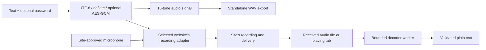

# Architecture & trust boundaries

## Data flow

`src/codec.mjs` owns packet construction, compression, encryption, tone modulation, CRC validation and acoustic decoding. The v3 packet layout remains compatible with earlier SonicQR recordings. `src/media.mjs` owns browser file decoding, worker lifecycle and bounded PCM capture. `src/panel.mjs` owns transient UI state, user gestures and the selected target.

`background.js` accepts only the extension's exact `panel.html` sender and known command types. It validates tab identifiers, injects the recording adapter into the selected top frame and manages optional per-site early-hook registrations. The ordinary path uses `activeTab`; no permanent host permission is granted on install.

## Audio protocol

The packet is `SQ`, version 3, profile ID, flags, two-byte payload length, payload and CRC-16/CCITT. UTF-8 text is capped at 500 Unicode code points and 2000 bytes. Deflate is used only when it saves space. Encrypted payloads contain an 8-byte random salt, a 12-byte random IV and AES-GCM ciphertext including its authentication tag. PBKDF2-SHA-256 uses 100,000 iterations to derive a non-exportable 256-bit key; this is retained for v3 compatibility. Password strength matters because an audio holder can attempt guesses offline. The v3 header is checked by CRC but is not authenticated as AES-GCM additional data.

Two nibbles per byte select from sixteen tones. The audible profile uses 1–7 kHz; the experimental high-frequency profile uses 14.5–18.7 kHz. A preamble and marker aid synchronization. Decoding uses tone-power measurements, bounded timing candidates and CRC checks. AES-GCM then verifies encrypted content. CRC detects corruption; it is not a signature or sender authentication.

The existing text cap fits within the 120-second receiver limit, including encryption overhead. Signal duration is calculated from the actual symbol count; generation also validates packet size, amplitude and a 117-second signal budget, preserving room for recording startup. Files are capped at 25 MiB, decoded audio at 120 seconds, decompressed text at 2001 bytes before rejection, and worker time at 45 seconds. Chrome's native `decodeAudioData` decodes a file before its duration can be checked; compressed-byte and post-decode duration caps do not constitute a hard cap on the browser decoder's internal memory allocation.

## Recording lifecycle

Arming prepares an AudioContext for one recording and expires after two minutes. The adapter wraps eligible audio-only `getUserMedia`, MediaRecorder construction/start, and Web Audio input consumers. Camera and screen-capture calls pass through. Tone playback waits for a consumer or an explicit manual start. Pausing or stopping early marks the result incomplete. Cloned output tracks and reused microphone streams are tracked so an existing site stream can keep working.

The microphone is never connected to the speakers. Tab capture is intentionally monitored so capturing a playing message does not mute it for the user. Capture stops its tracks and context on completion or panel closure; errors during context construction also release the acquired stream. Closing the panel cancels an unused or waiting arm; it does not stop a site's own ongoing recording.

Target lookups and polls carry a revision. Responses from an older tab cannot overwrite the current target. Target changes received during active work are deferred until it is safe to switch. Fields and cached audio/results can be cleared explicitly. Only language is stored in local storage; tab selection uses session storage.

## Security boundary

The MAIN-world adapter is part of the website's execution environment. A site may read, modify, bypass or fake its recording hooks and status. This is required to reach the site's recording APIs and is **not** treated as an isolated trusted environment. Encryption and password entry remain in the extension; only the constructed packet is passed into the page. A malicious page or recipient can record, replay, replace or corrupt audio. Never interpret a successful local status as proof of delivery.

The extension bundles code, workers, icons and licenses. It uses a restrictive extension CSP, no inline scripts, no dynamic code evaluation and no runtime network clients. Decoded content enters the UI through `textContent`. Diagnostic exports omit message content, passwords, packets, samples and full URLs. The selected site's origin is included because compatibility varies by site; review it before sharing.

See [Chrome's MAIN-world warning](https://developer.chrome.com/docs/extensions/reference/manifest/content-scripts#world) and [tab capture behavior](https://developer.chrome.com/docs/extensions/reference/api/tabCapture).
