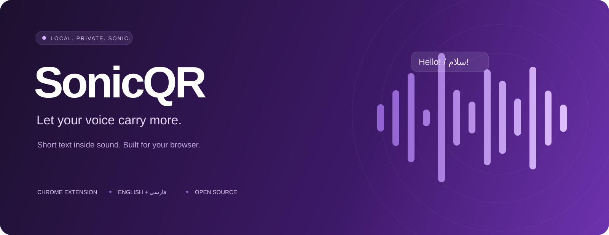

<div align="center">



**متن کوتاه، همراه وویس — محلی، متن‌باز و با رابط فارسی**

[دانلود افزونه](https://github.com/maboox/SonicQrChrome/releases/tag/v0.4.0) · [English](../README.md) · [حریم خصوصی](../PRIVACY.md) · [گزارش ایراد](https://github.com/maboox/SonicQrChrome/issues/new/choose)

</div>

<div dir="rtl">

SonicQR یک افزونهٔ دسکتاپ Chrome است: متن کوتاه را به سیگنال صوتی تبدیل می‌کند، آن را در وویس ضبط‌شدهٔ سایت قرار می‌دهد و متن را از فایل صوتی یا صدای تب دوباره می‌خواند. تمام پردازش داخل مرورگر انجام می‌شود و سرور، حساب کاربری یا ابزار آمارگیری ندارد.

**این نسخه آزمایشی است.** مسیرهای ضبط مرورگر تست شده‌اند؛ سالم‌ماندن پیام بعد از فشرده‌سازی هر پیام‌رسان باید با فایل واقعیِ دریافت‌شده آزمایش شود. ابتدا متن کوتاه و حالت واضح را امتحان کن. فرکانس‌بالا ممکن است کاملاً حذف شود.

## نصب

۱. از [Releases](https://github.com/maboox/SonicQrChrome/releases/tag/v0.4.0)، فایل `sonicqr-chrome-0.4.0-webstore.zip` را دانلود و در یک پوشهٔ ثابت استخراج کن.

۲. صفحهٔ `chrome://extensions` را باز کن و **Developer mode** را روشن کن.

۳. **Load unpacked** را بزن و پوشه‌ای را انتخاب کن که `manifest.json` داخل آن است.

۴. افزونه را کنار نوار آدرس Pin کن. در **تب وب پیام‌رسان** روی آیکون SonicQR کلیک کن.

Chrome دسکتاپ نسخهٔ ۱۱۶ یا جدیدتر لازم است. ساخت از سورس برای نصب الزامی نیست. پس از به‌روزرسانی، افزونه و تب سایت را هر دو Reload کن؛ کد ضبط قبلی تا بارگذاری مجدد در سایت می‌ماند. انتشار در Chrome Web Store مرحله‌ای جداگانه است و این ریپو ادعای حضور در فروشگاه ندارد.

## ابتدا یک آزمایش محلی

پایین پنل **آزمایش داخلی ضبط و استخراج متن** را باز کن. متن کوتاه بنویس، حالت واضح را انتخاب کن، ضبط را شروع کن و به میکروفون اجازه بده. صحبت کن، تا پایان سیگنال صبر کن و توقف را بزن. برنامه واقعاً صدا را به WebM/Opus ضبط می‌کند و متن را از همان فایل می‌خواند. وویس ترکیبی قابل دانلود است.

این تست، کدک ضبط مرورگر را بررسی می‌کند؛ پردازش سرور پیام‌رسان یا عملکرد همهٔ میکروفون‌ها را تضمین نمی‌کند.

## ارسال

۱. در تب مقصد روی افزونه کلیک کن، متن را بنویس و **ساخت سیگنال** را بزن.

۲. در بخش **رمز و تنظیمات سیگنال** می‌توانی رمز یا قدرت صدا را تعیین کنی. رمز را جداگانه به گیرنده بده.

۳. **فعال کردن ترکیب برای یک ضبط** را بزن؛ سپس دکمهٔ ضبط وویس **خود سایت** را فشار بده و صحبت کن.

۴. حداقل زمان نمایش‌داده‌شده را ضبط کن. پس از تکمیل سیگنال، ضبط سایت را متوقف، پیش‌نمایش را بررسی و خودت ارسال کن. افزونه پیام یا فایل ارسال نمی‌کند.

۵. برای وویس بعدی دوباره فعال‌سازی کن. فعال‌سازی مصرف‌نشده پس از دو دقیقه منقضی می‌شود.

فایل WAV دانلودی فقط **صدای متن** است؛ صدای ترکیبی را سایت ضبط می‌کند. افزونه صدای میکروفون را از بلندگو پخش نمی‌کند.

## اگر سایت همکاری نکرد

بعضی سایت‌ها توابع ضبط را خیلی زود آماده می‌کنند. از بخش **سازگاری بیشتر با این سایت**، فقط به همان سایت دسترسی بده، پیش‌نویس را ذخیره کن و تب را Reload کن. حالا کد سازگاری از آغاز بارگذاری سایت آماده می‌شود. از همان بخش دسترسی را حذف کن؛ برای حذف کدِ از قبل بارگذاری‌شده، تب‌های آن سایت را هم Reload کن.

اگر سایت در حال ضبط است ولی پنل می‌گوید ورودی ترکیبی منتظر است، دکمهٔ شروع دستی سیگنال را بزن و از آن لحظه تا پایان سیگنال ضبط کن.

وضعیت تکمیل، فقط خروجی محلی را توصیف می‌کند. **برای اطمینان از انتقال، فایل دریافت‌شده در طرف گیرنده را بخوان.** فشرده‌سازی یا فیلتر صوتی پیام‌رسان ممکن است سیگنال را خراب کند. افزایش قدرت، فرکانسی را که حذف شده برنمی‌گرداند.

## دریافت و خواندن

- **فایل:** وویس اصلی را دانلود و در بخش خواندن پیام انتخاب کن. WAV، WebM، OGG/Opus، MP3 و دیگر فرمت‌های قابل‌خواندن توسط Chrome پذیرفته می‌شوند. سقف: **۲۵ مگابایت و ۱۲۰ ثانیه**.
- **صدای تب:** در تب پخش‌کننده روی آیکون افزونه کلیک کن، دریافت صدای تب را شروع کن، وویس را از ابتدا پخش کن و سپس توقف و استخراج متن را بزن. صدای همان تب همچنان پخش می‌شود؛ سایر تب‌ها و برنامه‌ها ضبط نمی‌شوند.

اگر پیام رمز دارد، رمز را وارد و تلاش دوباره را بزن. وقتی بستهٔ معتبر پیدا شده باشد، تلاش با رمز جدید به تحلیل مجدد صدا نیاز ندارد. دکمهٔ پاک‌کردن، متن، رمزها، صوتِ نگه‌داشته‌شده در پنل و نتیجه را کنار می‌گذارد؛ فایل دانلودشده یا ضبط نگه‌داشته‌شده در خود سایت را حذف نمی‌کند.

## حریم خصوصی و محدودیت‌ها

- متن، رمز و صوت توسط افزونه به شبکه فرستاده نمی‌شوند. فقط زبان رابط ذخیرهٔ دائمی دارد؛ شناسهٔ تب مقصد در حافظهٔ نشست مرورگر است. دسترسی اختیاری سایت تا لغوکردن باقی می‌ماند.
- خود سایت به صدای ترکیبی دسترسی دارد. بدون رمز، هر دارندهٔ فایل می‌تواند متن را بخواند. رمزگذاری AES-256-GCM متن را محافظت می‌کند، اما وجود سیگنال را پنهان و هویت فرستنده را تأیید نمی‌کند.
- کد سازگاری در محیط اجرای خود سایت کار می‌کند و سایت می‌تواند در آن دخالت کند. رمز داخل افزونه پردازش می‌شود؛ بستهٔ رمز‌شده به سایت می‌رسد.
- گزارش عیب‌یابی فقط با درخواست تو کپی می‌شود: دامنه، نسخه، مسیر ضبط، سطح و زمان. متن، رمز، بسته، صوت و آدرس کامل در گزارش نیستند.
- اپ مستقل ویندوز و موبایل، Chrome معمولی اندروید، فریم‌های دلخواه، تماس تصویری و همهٔ مسیرهای WebRTC در محدودهٔ تست‌شده نیستند.
- حالت فرکانس‌بالا تضمین «نامرئی» یا «غیرقابل‌شنیدن» ندارد. این برنامه پروتکل متن در صوت است، نه خوانندهٔ تصویر QR.

## توسعه و انتشار

Node.js 24 نصب کن و دستورهای زیر را اجرا کن:

</div>

```sh
npm ci
npx playwright install chromium
npm run check
npm run package
```

<div dir="rtl">

سورس اصلی در `src/` است. پس از تغییر، `npm run build` را اجرا کن. فایل‌های آمادهٔ ریشه عمداً در ریپو هستند تا Load unpacked بدون ساخت هم کار کند. بستهٔ خروجی در `dist/` فقط فایل‌های مجاز اجرا را همراه checksum دارد.

[معماری](ARCHITECTURE.md)، [محدودهٔ تست‌ها](../VALIDATION.md)، [سیاست امنیت](../SECURITY.md) و [راهنمای انتشار فروشگاه](../PUBLISHING.md) را ببین. مجوز پروژه [MIT](../LICENSE) است؛ اعتبار کتابخانه‌ها و آیکون‌ها در [Third-party notices](../THIRD_PARTY_NOTICES.md) آمده است.

</div>
